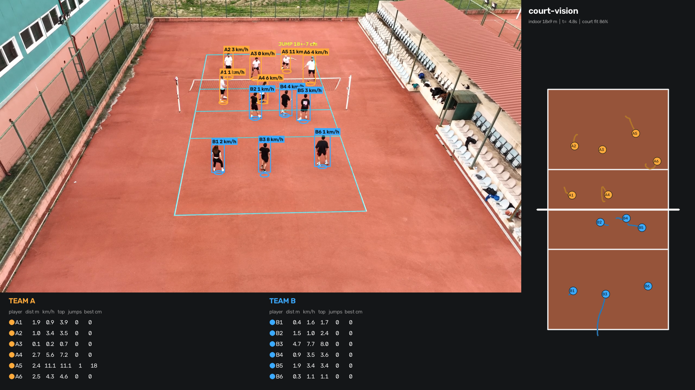
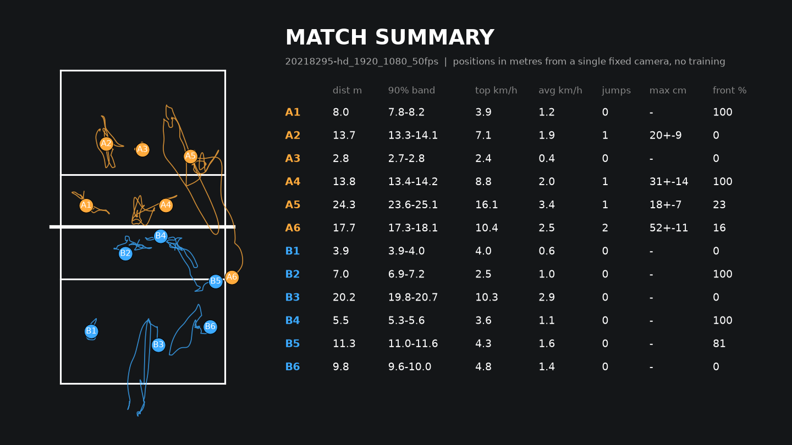
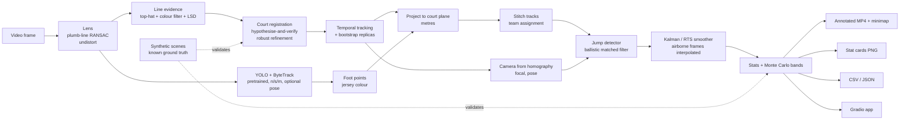

# court-vision

Volleyball analytics from one fixed camera, with no model training: classical computer vision and
3D geometry around a pretrained person detector. Point it at amateur footage and get player
positions in metres, distance, speed, jumps, heatmaps and an annotated video with a live top-down
minimap.


The clip above is drone footage of an outdoor court. The court is found from its painted lines,
re-registered on every frame (the drone drifts), and every player is tracked on the court plane.

| Best frame | Match summary card |
|---|---|
|  |  |

## What it does

1. **Lens** - estimates radial distortion from straight court lines (plumb-line method with
   RANSAC over line chains, one-parameter division model) and undistorts. No checkerboard.
2. **Court registration** - line segments (LSD, with a white-line colour filter) are merged into
   lines; two pairs of lines plus a template assignment give a homography hypothesis, scored by how
   much of the full court template lands on line pixels (hypothesise-and-verify over line
   correspondences, exhaustive when small, randomly sampled when large). The winner is refined with a
   robust least-squares fit on all line pixels and tracked frame to frame. Templates: indoor 18x9 m,
   beach 16x8 m, plus padel and 5/7-a-side football.
3. **Players** - pretrained Ultralytics YOLO (weights downloaded from GitHub) + ByteTrack;
   fragments broken by occlusion are stitched in court space; teams from side of the net plus jersey
   colour clustering; foot points projected to the court plane and smoothed with a Kalman/RTS filter
   in metres.
4. **Jumps** - a jump is a short ballistic bump of the foot point along the projected vertical.
   During the airborne phase the ground position is interpolated between take-off and landing
   instead of projecting the airborne point, and height is measured from the camera recovered from
   the homography. An optional pose model supplies ankle keypoints.
5. **Stats** - distance, top/average speed, jump count, max/average jump height, heatmap,
   front-row vs back-row occupancy, each with a 90% band from Monte Carlo propagation of homography
   uncertainty (block bootstrap of the line fit), foot-localisation bias and tracker jitter.
6. **Outputs** - side-by-side annotated MP4 (H.264) with minimap, per-player stat cards (PNG),
   CSV/JSON, GIF, and a Gradio app.
7. **Validation** - synthetic courts rendered with known intrinsics, pose and distortion, clutter
   lines from basketball and badminton, simulated players with occlusions and jumps.

## Architecture



| Module | File |
|---|---|
| Lens | `courtvision/lens.py` |
| Court registration | `courtvision/court.py`, `courtvision/templates.py` |
| Camera from homography | `courtvision/camera.py` |
| Players | `courtvision/players.py`, `courtvision/tracking.py` |
| Jumps | `courtvision/jumps.py` |
| Stats + Monte Carlo | `courtvision/stats.py` |
| Rendering, exports | `courtvision/render.py`, `courtvision/pipeline.py` |
| Synthetic scenes, validation | `courtvision/synth.py`, `courtvision/validate.py` |

## Quick start

```bash
pip install -r requirements.txt
python -m courtvision run clip.mp4 --out results/clip --frame-stride 2
```

Useful flags:

| Flag | Meaning |
|---|---|
| `--device auto\|cpu\|cuda` | auto-detects CUDA |
| `--model-size n\|s\|m` | YOLO size |
| `--pose` | pose model: ankle keypoints for foot points and jumps |
| `--frame-stride N`, `--max-frames N` | fast development runs on CPU |
| `--court indoor\|beach\|padel\|football5\|football7` | court template |
| `--undistort auto\|off\|<lambda>` | lens handling |
| `--line-color white\|any` | `any` if your court lines are not white |

Outputs in `--out`: `*_annotated.mp4`, `*_demo.gif`, `best_frame.png`, `cards/*.png`,
`player_stats.csv`, `positions.csv`, `jumps.csv`, `summary.json`.

Other entry points:

```bash
python app.py                                         # Gradio: upload clip -> results
python scripts/validate_synthetic.py --trials 24      # synthetic validation + sensitivity
python scripts/benchmark.py clip.mp4 --device cuda --model-size s   # FPS per stage
pytest                                                # tests
```

## Results

Full tables: [docs/RESULTS.md](docs/RESULTS.md).

### Synthetic validation

Each scenario is 24 random scenes: a camera 25-60 degrees above the horizon (unless stated),
12 players for 20 s at 25 fps, 1.5 px foot noise, occlusion gaps, jumps of 20-75 cm. Court
registration runs on the rendered image; player detections are simulated (noisy foot pixels with
dropouts and known identity), so these numbers cover geometry, smoothing, jumps and stats, not the
YOLO detector or ID switches.

| Scenario | Court found | Reproj. median (cm) | Reproj. p90 (cm) | Position RMSE (cm) | Distance err | Truth in 90% band | Top-speed err (m/s) | Jump recall | Jump precision | Jump MAE (cm) | Flight-time MAE (cm) |
|---|---|---|---|---|---|---|---|---|---|---|---|
| baseline (clutter, coloured other-sport lines) | 100% of 24 | 0.5 | 0.8 | 6.1 | 1.1% | 91% | 0.10 | 54% | 86% | 6.2 | 6.9 |
| no clutter | 100% of 24 | 0.4 | 0.8 | 6.1 | 1.0% | 92% | 0.10 | 56% | 88% | 6.2 | 7.0 |
| clutter, ALL lines white (worst case) | 62% of 24 | 1.1 | 1.8 | 6.3 | 1.1% | 90% | 0.11 | 57% | 84% | 6.7 | 7.6 |
| foot noise 0.5 px | 100% of 24 | 0.5 | 0.8 | 5.6 | 1.0% | 93% | 0.10 | 54% | 98% | 5.3 | 5.3 |
| foot noise 3 px | 100% of 24 | 0.5 | 0.8 | 8.0 | 1.1% | 88% | 0.13 | 47% | 70% | 7.1 | 9.1 |
| foot noise 5 px | 100% of 24 | 0.5 | 0.8 | 10.3 | 1.1% | 94% | 0.13 | 31% | 68% | 10.0 | 11.5 |
| low camera (elev 20 deg) | 100% of 24 | 2.5 | 3.8 | 7.9 | 1.0% | 91% | 0.11 | 79% | 99% | 4.6 | 4.4 |
| high camera (elev 65 deg) | 100% of 24 | 0.2 | 0.5 | 6.4 | 1.1% | 88% | 0.11 | 18% | 50% | 13.3 | 20.7 |
| occlusion gaps x3 | 100% of 24 | 0.5 | 0.8 | 8.5 | 1.5% | 77% | 0.12 | 41% | 83% | 6.8 | 7.0 |
| aggressive movement (accel up to 8 m/s^2) | 100% of 24 | 0.5 | 0.8 | 10.5 | 3.7% | 22% | 0.15 | 54% | 55% | 5.8 | 6.4 |
| mid camera (elev 45 deg) | 100% of 24 | 0.4 | 0.9 | 6.1 | 1.1% | 90% | 0.11 | 58% | 89% | 5.3 | 5.8 |
| barrel distortion lam=-0.10, corrected | 100% of 24 | 0.9 | 1.4 | 6.1 | 1.0% | 92% | 0.11 | 55% | 85% | 6.3 | 6.9 |
| barrel distortion lam=-0.25, corrected | 100% of 24 | 1.0 | 2.0 | 6.2 | 1.0% | 93% | 0.11 | 54% | 86% | 6.0 | 6.6 |
| barrel distortion lam=-0.10, NOT corrected | 100% of 24 | 10.8 | 20.8 | 11.3 | 0.9% | 94% | 0.13 | 56% | 48% | 7.8 | 8.0 |
| heavy image noise (sigma 15) | 100% of 24 | 0.3 | 0.5 | 6.1 | 1.0% | 90% | 0.10 | 54% | 88% | 6.1 | 6.9 |
| beach court (4 lines only) | 100% of 24 | 0.6 | 1.0 | 6.4 | 1.2% | 87% | 0.10 | 61% | 83% | 5.7 | 6.0 |

How to read it:

- **Court found** counts a scene as a success only if the fitted court is within 50 cm of the truth.
- **Flight-time MAE** is the error of the second, independent height estimate `g*T^2/8`.
- **Truth in 90% band** is how often the true distance falls inside the reported band.

What the sweep shows:

- **Court registration** finds the court in every baseline scene with about half a centimetre of
  median error, including with basketball and badminton lines in other colours, heavy image noise
  and the 4-line beach court. The weak case is a hall where every sport's lines are white: 62%.
- **Distance and speed** are within about 1% and 0.1 m/s. Very abrupt movement (8 m/s^2) raises
  the distance error to 3.7% and the 90% band then contains the truth only 22% of the time,
  because the smoother cuts corners.
- **Lens**: uncorrected barrel distortion of -0.10 costs about 11 cm of court error; the
  plumb-line correction brings it back to about 1 cm.
- **Jumps** are the weakest output. With the conservative default thresholds, precision is 86%
  and recall 54% at baseline (height error about 6 cm), 99% / 79% from a low camera, and 50% / 18%
  from a steep 65-degree camera. Missed jumps are mostly the small ones (20-30 cm).
- **Known defect on real footage**: jump counts on the near-overhead clip (`topdown`, 18 jumps up
  to 76 cm) and for one player in the `diagonal` clip (7 jumps) are not credible. From overhead the
  focal length cannot be recovered from the court plane, so the observability gate is computed from
  a wrong camera. Treat jump output as experimental unless the camera is low and oblique.

### Real footage

End-line clip (the demo above):

- 636 frames at 25 fps (stride 2), yolo11n.pt on cpu
- Court registered in 100.0% of frames, 1 full detection(s), mean line coverage 0.87, line residual 1.05 px
- Court-corner motion per frame: 0.68 px raw, 0.09 px after temporal smoothing
- Lens: plumb-line estimate lambda = +0.035, undistortion applied: False
- Tracks: 24 raw ByteTrack ids -> 12 players (1 fragments stitched); teams by side+colour

| Player | Tracked (s) | Distance (m) | 90% band | Top speed (km/h) | Avg speed (km/h) | Jumps | Max jump (cm) | Front row |
|---|---|---|---|---|---|---|---|---|
| A1 | 24.9 | 8.0 | 7.8-8.2 | 3.9 | 1.2 | 0 | - | 100% |
| A2 | 25.4 | 13.7 | 13.3-14.1 | 7.1 | 1.9 | 1 | 20 ± 9 | 0% |
| A3 | 25.4 | 2.8 | 2.7-2.8 | 2.4 | 0.4 | 0 | - | 0% |
| A4 | 25.4 | 13.8 | 13.4-14.2 | 8.8 | 2.0 | 1 | 31 ± 14 | 100% |
| A5 | 25.4 | 24.3 | 23.6-25.1 | 16.1 | 3.4 | 1 | 18 ± 7 | 23% |
| A6 | 25.4 | 17.7 | 17.3-18.1 | 10.4 | 2.5 | 2 | 52 ± 11 | 16% |
| B1 | 25.4 | 3.9 | 3.9-4.0 | 4.0 | 0.6 | 0 | - | 0% |
| B2 | 25.4 | 7.0 | 6.9-7.2 | 2.5 | 1.0 | 0 | - | 100% |
| B3 | 25.4 | 20.2 | 19.8-20.7 | 10.3 | 2.9 | 0 | - | 0% |
| B4 | 17.4 | 5.5 | 5.3-5.6 | 3.6 | 1.1 | 0 | - | 100% |
| B5 | 25.4 | 11.3 | 11.0-11.6 | 4.3 | 1.6 | 0 | - | 81% |
| B6 | 25.4 | 9.8 | 9.6-10.0 | 4.8 | 1.4 | 0 | - | 0% |

There is no ground truth for the real clips, so these numbers are plausibility-checked only
(overlay alignment by eye, speeds in a human range). Jump heights on real footage are the least
trustworthy output: box bottoms move when legs are occluded, and only an occlusion check on box
height guards against that.

### Speed

CPU baseline (cpu: x86_64 x12)

| Stage | ms / frame | FPS |
|---|---|---|
| lens_estimate (once per clip) | 278 | - |
| decode | 2.5 | 398.2 |
| court_registration | 68.7 | 14.6 |
| detect_track | 147.0 | 6.8 |
| analysis | 4.7 | 214.4 |
| stat_cards (once per clip) | 3216 | - |
| render | 34.8 | 28.7 |
| encode | 12.0 | 83.2 |
| **total per frame** | 269.7 | **3.7** |

Rerun on a GPU with `python scripts/benchmark.py clip.mp4 --device cuda`; detection is the
bottleneck on CPU and the stage that moves to the GPU.

## Limitations

- The camera must not pan or zoom. Slow drift is tracked.
- Court lines must be visible. Halls where every sport's lines share one colour are a known weak
  case (see the table). `--line-color` and the strength-weighted scoring help only when the
  volleyball lines differ in colour or contrast.
- Jump height needs an oblique view. From a height `Cz` at horizontal distance `rho`, a jump of `z`
  moves the apparent ground point by `z*rho/Cz`; under a steep camera this is indistinguishable
  from a quick step, and such jumps are dropped rather than reported.
- Foot points come from box bottoms (or ankles with `--pose`); legs hidden behind the net shift
  them.
- Player labels are per clip. No jersey numbers, no ball tracking.
- Uncertainty bands cover calibration, foot bias and tracker jitter; they do not cover identity
  switches.

## Hire me

I build computer-vision pipelines like this one for sports clubs, venues and product teams:
player tracking and statistics from your footage, camera calibration and top-down views, and
deployment on edge devices next to your cameras.

- Upwork: <<UPWORK_PROFILE_URL>>
- GitHub: https://github.com/phamthaihoangtung

Send a 30-second sample clip and I will tell you what accuracy to expect before you commit.

## License

MIT for the code. YOLO weights are downloaded from Ultralytics at run time and carry their own
licence (AGPL-3.0 / Ultralytics Enterprise) - check it before commercial deployment.
