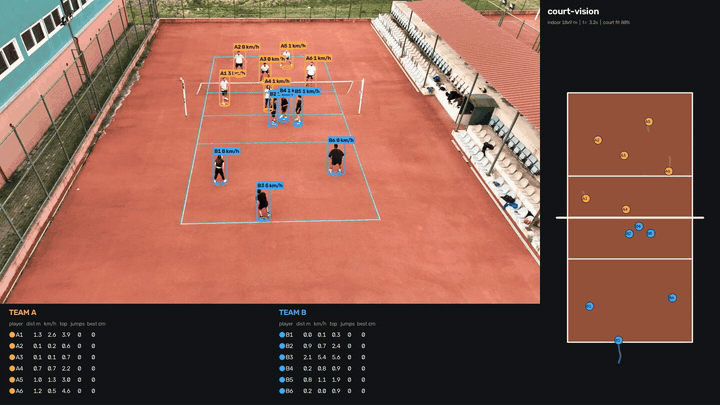
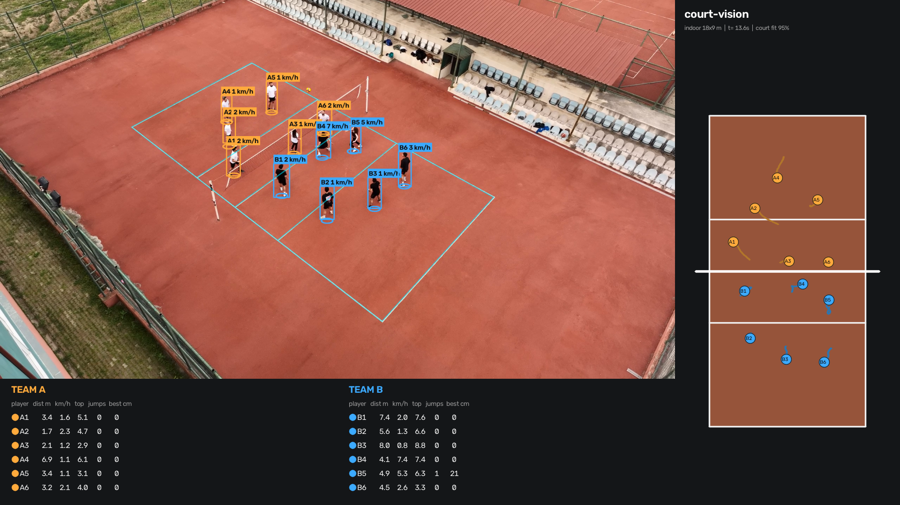
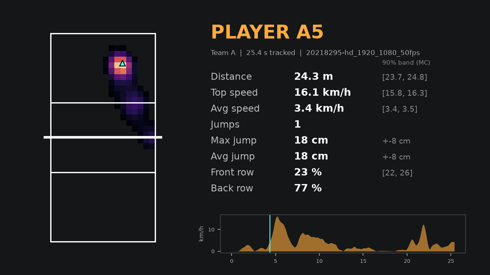
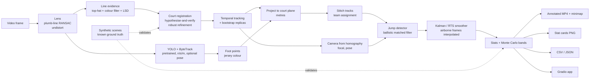

# court-vision

Volleyball analytics from one fixed camera: classical computer vision and 3D geometry around a
pretrained person detector. Point it at amateur footage and get player positions in metres,
distance, speed, jumps, heatmaps and an annotated video with a live top-down minimap.



The clip above is drone footage of an outdoor court. The court is found from its painted lines,
re-registered on every frame (the drone drifts), and every player is tracked on the court plane.
The demo outputs come from the online mode: frames go in one at a time and results come out with a
fixed 2 s delay, which is the logic a live camera feed would run (see [Online mode](#online-mode)).

| Best frame | Match summary card |
|---|---|
|  |  |
|  |  |

## What it does

1. **Lens** - estimates radial distortion from straight court lines (plumb-line method with
   RANSAC over line chains, one-parameter division model) and undistorts. No checkerboard.
2. **Court registration** - line segments (LSD, with a white-line colour filter) are merged into
   lines; two pairs of lines plus a template assignment give a homography hypothesis, scored by how
   much of the full court template lands on line pixels (hypothesise-and-verify over line
   correspondences, exhaustive when small, randomly sampled when large). The winner is refined with a
   robust least-squares fit on all line pixels and tracked frame to frame. Templates: indoor 18x9 m,
   beach 16x8 m, plus padel and 5/7-a-side football.
3. **Players** - pretrained Ultralytics YOLO (weights downloaded from GitHub) + ByteTrack;
   fragments broken by occlusion, or by ByteTrack handing a player to a new id, are stitched in
   court space (a new id may overlap the old one for up to 2 s if both sit on the same spot, and
   not when another player stands within 1 m); teams from side of the net plus jersey colour
   clustering; foot points projected to the court plane and smoothed with a Kalman/RTS filter in
   metres.
4. **Jumps** - a jump is a short ballistic bump of the foot point along the projected vertical.
   During the airborne phase the ground position is interpolated between take-off and landing
   instead of projecting the airborne point, and height is measured from the camera recovered from
   the homography. An optional pose model supplies ankle keypoints.
5. **Stats** - distance, top/average speed, jump count, max/average jump height, heatmap,
   front-row vs back-row occupancy, each with a 90% band from Monte Carlo propagation of homography
   uncertainty (block bootstrap of the line fit), foot-localisation bias and tracker jitter.
6. **Outputs** - side-by-side annotated MP4 (H.264) with minimap, per-player stat cards (PNG),
   CSV/JSON, GIF, and a Gradio app.
7. **Online mode** - the same analysis frame by frame with a fixed output delay; see below.
8. **Validation** - synthetic courts rendered with known intrinsics, pose and distortion, clutter
   lines from basketball and badminton, simulated players with occlusions and jumps.

## Architecture



| Module | File |
|---|---|
| Lens | `courtvision/lens.py` |
| Court registration | `courtvision/court.py`, `courtvision/templates.py` |
| Camera from homography | `courtvision/camera.py` |
| Players | `courtvision/players.py`, `courtvision/tracking.py` |
| Jumps | `courtvision/jumps.py` |
| Stats + Monte Carlo | `courtvision/stats.py` |
| Online analysis (fixed delay) | `courtvision/online.py` |
| Rendering, exports | `courtvision/render.py`, `courtvision/pipeline.py` |
| Synthetic scenes, validation | `courtvision/synth.py`, `courtvision/validate.py` |

## Quick start

```bash
pip install -r requirements.txt
python -m courtvision run clip.mp4 --out results/clip --frame-stride 2
```

Useful flags:

| Flag | Meaning |
|---|---|
| `--device auto\|cpu\|cuda` | auto-detects CUDA |
| `--model-size n\|s\|m` | YOLO size |
| `--pose` | pose model: ankle keypoints for foot points and jumps |
| `--frame-stride N`, `--max-frames N` | fast development runs on CPU |
| `--court indoor\|beach\|padel\|football5\|football7` | court template |
| `--undistort auto\|off\|<lambda>` | lens handling |
| `--line-color white\|any` | `any` if your court lines are not white |
| `--online`, `--lag 2.0` | frame-by-frame analysis with a fixed output delay (the demo uses it) |
| `--reuse-pass1` | reuse the cached registration + detections in `--out` (re-analyse without YOLO) |

Outputs in `--out`: `*_annotated.mp4`, `*_demo.gif`, `best_frame.png`, `cards/*.png`,
`player_stats.csv`, `positions.csv`, `jumps.csv`, `summary.json`.

Other entry points:

```bash
python app.py                                         # Gradio: upload clip -> results
python scripts/validate_synthetic.py --trials 24      # synthetic validation + sensitivity
python scripts/benchmark.py clip.mp4 --device cuda --model-size s   # FPS per stage
python scripts/compare_online.py                      # online vs offline on the cached clip runs
pytest                                                # tests
```

## Online mode

A live feed cannot look at the whole clip. `courtvision/online.py` takes one frame at a time
(court registration + detections from YOLO/ByteTrack, which are already causal) and finalises each
frame `lag_s` (default 2 s) later. Nothing reads further ahead than that delay.

- **Warm-up (first 3 s)**: the offline logic runs once on this window to set the focal length, 12
  player slots, the two teams and their kit colours, and each team's side of the net.
- **Every frame**: a slot only continues with its own ByteTrack id. If that id starts showing the
  other team's kit for 5 frames in a row, ByteTrack has moved it to another player and the slot lets
  it go.
- **Id changes**: detections with an id nobody owns become tracklets. Once a tracklet has lasted
  0.5 s, all live tracklets and all lost slots are matched in one assignment, and the ripe ones are
  written back into their slot. The delay leaves room to revise those frames, so a tracklet is not
  handed to the wrong slot just because the right player reappears a moment later.
- **Every 0.2 s**: frames that are now 2 s old are finalised with the offline code: homography
  smoothing, jump detection (a jump is committed once its landing is seen), RTS smoothing on a
  sliding window, and the same Monte Carlo bands. Stats describe the match up to `now - 2 s`.

Online vs offline on the same detections (`python scripts/compare_online.py`); "same person" is the
share of frames where both name the same player (< 0.5 m apart):

| Clip | Coverage offline | Coverage online | Same person | Players that differ |
|---|---|---|---|---|
| diagonal | 94.3% | 97.2% | 100.0% | B4: 94% -> 99% covered, 100% same; A2: 39% -> 69% covered, 100% same |
| endline | 97.4% | 100.0% | 99.2% | A6: 100% -> 100% covered, 91% same; B4: 69% -> 100% covered, 100% same |
| topdown | 96.8% | 97.1% | 100.0% | B4: 100% -> 96% covered, 100% same; A6: 64% -> 71% covered, 100% same; B1: 97% -> 100% covered, 100% same |

The offline run on the end-line clip follows a ByteTrack id switch at the end of the clip and puts
a team-A label on a team-B player for the last 2 s; the kit check in online mode does not. The
delay trades latency for coverage: who-is-who is the same from 1 s to 3 s, but a gap longer than
the delay cannot be bridged, so top-down coverage is 94.8% at 1 s, 96.1% at 1.5 s, 97.1% at 2 s
and 97.6% at 3 s. On simulated matches where
ByteTrack gives a new id after every occlusion, online tracking is as good as or better than the
offline stitching on all 8 seeds tried; when two players of the same team cross while both are
hidden, either method can swap them.

## Results

Full tables: [docs/RESULTS.md](docs/RESULTS.md).

### Synthetic validation

Each scenario is 24 random scenes: a camera 25-60 degrees above the horizon (unless stated),
12 players for 20 s at 25 fps, 1.5 px foot noise, occlusion gaps, jumps of 20-75 cm. Court
registration runs on the rendered image; player detections are simulated (noisy foot pixels with
dropouts and known identity), so these numbers cover geometry, smoothing, jumps and stats, not the
YOLO detector or ID switches.

| Scenario | Court found | Reproj. median (cm) | Reproj. p90 (cm) | Position RMSE (cm) | Distance err | Truth in 90% band | Top-speed err (m/s) | Jump recall | Jump precision | Jump MAE (cm) | Flight-time MAE (cm) |
|---|---|---|---|---|---|---|---|---|---|---|---|
| baseline (clutter, coloured other-sport lines) | 100% of 24 | 0.5 | 0.8 | 6.1 | 1.1% | 91% | 0.10 | 53% | 90% | 5.8 | 6.6 |
| no clutter | 100% of 24 | 0.4 | 0.8 | 6.1 | 1.0% | 91% | 0.10 | 54% | 90% | 5.8 | 6.7 |
| clutter, ALL lines white (worst case) | 62% of 24 | 1.1 | 1.8 | 6.3 | 1.1% | 91% | 0.11 | 54% | 88% | 6.2 | 7.1 |
| foot noise 0.5 px | 100% of 24 | 0.5 | 0.8 | 5.6 | 1.0% | 93% | 0.10 | 51% | 97% | 4.8 | 4.6 |
| foot noise 3 px | 100% of 24 | 0.5 | 0.8 | 8.1 | 1.2% | 86% | 0.13 | 48% | 71% | 7.2 | 9.1 |
| foot noise 5 px | 100% of 24 | 0.5 | 0.8 | 10.4 | 1.1% | 91% | 0.14 | 32% | 65% | 10.2 | 11.9 |
| low camera (elev 20 deg) | 100% of 24 | 2.5 | 3.8 | 7.9 | 1.0% | 91% | 0.11 | 77% | 99% | 4.4 | 4.2 |
| high camera (elev 65 deg) | 100% of 24 | 0.2 | 0.5 | 6.4 | 1.1% | 86% | 0.11 | 16% | 55% | 13.8 | 21.3 |
| occlusion gaps x3 | 100% of 24 | 0.5 | 0.8 | 8.5 | 1.5% | 77% | 0.12 | 39% | 87% | 6.4 | 6.7 |
| aggressive movement (accel up to 8 m/s^2) | 100% of 24 | 0.5 | 0.8 | 10.5 | 3.6% | 22% | 0.16 | 51% | 56% | 5.8 | 6.3 |
| mid camera (elev 45 deg) | 100% of 24 | 0.4 | 0.9 | 6.1 | 1.1% | 89% | 0.11 | 56% | 93% | 5.3 | 5.6 |
| barrel distortion lam=-0.10, corrected | 100% of 24 | 0.9 | 1.4 | 6.1 | 1.0% | 93% | 0.10 | 51% | 90% | 5.8 | 6.4 |
| barrel distortion lam=-0.25, corrected | 100% of 24 | 1.0 | 2.0 | 6.1 | 1.0% | 93% | 0.10 | 53% | 90% | 6.0 | 6.7 |
| barrel distortion lam=-0.10, NOT corrected | 100% of 24 | 10.8 | 20.8 | 11.3 | 0.8% | 93% | 0.13 | 54% | 56% | 7.9 | 8.0 |
| heavy image noise (sigma 15) | 100% of 24 | 0.3 | 0.5 | 6.0 | 1.0% | 91% | 0.10 | 53% | 91% | 5.9 | 6.7 |
| beach court (4 lines only) | 100% of 24 | 0.6 | 1.0 | 6.4 | 1.2% | 88% | 0.10 | 58% | 87% | 5.6 | 5.9 |

How to read it:

- **Court found** counts a scene as a success only if the fitted court is within 50 cm of the truth.
- **Flight-time MAE** is the error of the second, independent height estimate `g*T^2/8`.
- **Truth in 90% band** is how often the true distance falls inside the reported band.

What the sweep shows:

- **Court registration** finds the court in every baseline scene with about half a centimetre of
  median error. That holds with basketball and badminton lines in other colours, with heavy image
  noise, and on the 4-line beach court. The weak case is a hall where every sport's lines are
  white.
- **Distance and speed** are within about 1% and 0.1 m/s. Very abrupt movement (8 m/s^2) raises
  the distance error to about 4%, and the 90% band then rarely contains the truth, because the
  smoother cuts corners. The bands assume normal movement.
- **Lens**: uncorrected barrel distortion of -0.10 costs about 11 cm of court error; the
  plumb-line correction brings it back to about 1 cm.
- **Jumps** are the weakest output. Precision is high and recall is moderate: small jumps
  (20-30 cm) are the ones missed. A low, oblique camera sees jumps well. A steep camera (65
  degrees) cannot separate a jump from a quick step, and most jumps there are dropped rather than
  guessed.
- These synthetic detections have clean boxes. Real boxes also change with posture and occlusion,
  which is why jump precision on real footage is lower (see Limitations).

### Real footage

End-line clip (the demo above):

- 636 frames at 25 fps (stride 2), yolo11n.pt on cpu
- Court registered in 100.0% of frames, 1 full detection(s), mean line coverage 0.87, line residual 1.05 px
- Court-corner motion per frame: 0.68 px raw, 0.09 px after temporal smoothing
- Lens: plumb-line estimate lambda = +0.035, undistortion applied: False
- Analysis: online (output delay 2.0 s)
- Tracks: 24 raw ByteTrack ids -> 12 players (13 id changes resolved); teams by side+colour (warm-up)

| Player | Tracked (s) | Distance (m) | 90% band | Top speed (km/h) | Avg speed (km/h) | Jumps | Max jump (cm) | Front row |
|---|---|---|---|---|---|---|---|---|
| A1 | 25.4 | 8.0 | 7.9-8.3 | 3.3 | 1.1 | 0 | - | 100% |
| A2 | 25.4 | 13.8 | 13.3-14.2 | 7.1 | 2.0 | 0 | - | 0% |
| A3 | 25.4 | 2.8 | 2.7-2.9 | 2.4 | 0.4 | 0 | - | 0% |
| A4 | 25.4 | 13.2 | 12.9-13.6 | 8.8 | 1.9 | 0 | - | 100% |
| A5 | 25.4 | 24.3 | 23.7-24.8 | 15.9 | 3.4 | 1 | 18 ± 7 | 23% |
| A6 | 25.4 | 19.9 | 19.3-20.5 | 13.4 | 2.8 | 0 | - | 16% |
| B1 | 25.4 | 4.0 | 3.8-4.1 | 4.0 | 0.6 | 0 | - | 0% |
| B2 | 25.4 | 21.4 | 20.8-21.8 | 11.5 | 3.0 | 0 | - | 0% |
| B3 | 25.4 | 7.0 | 6.9-7.2 | 2.5 | 1.0 | 0 | - | 100% |
| B4 | 25.4 | 13.5 | 13.2-13.9 | 9.5 | 1.9 | 0 | - | 100% |
| B5 | 25.4 | 11.3 | 11.0-11.5 | 4.3 | 1.6 | 0 | - | 81% |
| B6 | 25.4 | 9.8 | 9.6-10.1 | 4.9 | 1.4 | 0 | - | 0% |

There is no ground truth for the real clips, so these numbers are plausibility-checked only
(overlay alignment by eye, speeds in a human range, identities checked by eye wherever online and
offline disagree). Jumps were checked by eye against the frames: see the jump section under
Limitations.

### Speed

CPU baseline (cpu: x86_64 x12)

| Stage | ms / frame | FPS |
|---|---|---|
| lens_estimate (once per clip) | 278 | - |
| decode | 2.5 | 398.2 |
| court_registration | 68.7 | 14.6 |
| detect_track | 147.0 | 6.8 |
| analysis | 4.7 | 214.4 |
| stat_cards (once per clip) | 3216 | - |
| render | 34.8 | 28.7 |
| encode | 12.0 | 83.2 |
| **total per frame** | 269.7 | **3.7** |

Rerun on a GPU with `python scripts/benchmark.py clip.mp4 --device cuda`; detection is the
bottleneck on CPU and the stage that moves to the GPU.

## Limitations

- The camera must not pan or zoom. Slow drift is tracked.
- Court lines must be visible. Halls where every sport's lines share one colour are a known weak
  case (see the table). `--line-color` and the strength-weighted scoring help only when the
  volleyball lines differ in colour or contrast.
- Jump height needs an oblique view. From a height `Cz` at horizontal distance `rho`, a jump of `z`
  moves the apparent ground point by `z*rho/Cz`; under a steep camera this is indistinguishable
  from a quick step, and such jumps are dropped rather than reported.
- **Jumps on real footage are conservative and still imperfect.** Foot points come from box
  bottoms (or ankles with `--pose`), and box bottoms also move when a player crouches, bends, or
  has their legs hidden by the net. Three checks reject those cases: the box must not shrink, the
  box top must rise with the feet, and the bump must be large compared with posture jitter. On the
  three demo clips the online run reports 9 jumps. By eye, 5 look like real jumps (an attack at the
  net, a jump set, two jump serves, a reach for the ball), 2 are unclear (a low dig, a serve toss)
  and 2 are wrong (a dive for the ball, two players overlapping in one box); some real blocks at
  the net are missed. Treat per-player jump counts as indicative, not as a stat to publish.
- Player labels are per clip. No jersey numbers, no ball tracking. When several players in the
  same kit huddle together, who is who after they split is a guess (online and offline can disagree
  there, and nothing in the image says which is right).
- A player who walks more than 3 m off the court (substitution, leaving) is no longer tracked.
- Online mode is about the logic, not real time yet: the analysis alone takes about 80 ms per frame
  on CPU, on top of detection and registration (see Speed).
- Uncertainty bands cover calibration, foot bias and tracker jitter; they do not cover identity
  switches.

## Next steps

- Guided re-detection: when a slot is lost, crop around its predicted position, upscale and run the
  detector with a low threshold, for small far-side players that YOLO misses at full frame.
- A live entry point (webcam / RTSP) around the online analyzer, with a fixed processing stride.
- GPU / TensorRT detection and cheaper per-frame registration (the camera is fixed) for real time.

## Hire me

I build computer-vision pipelines like this one for sports clubs, venues and product teams:
player tracking and statistics from your footage, camera calibration and top-down views, and
deployment on edge devices next to your cameras.

- Upwork: https://www.upwork.com/freelancers/tungpth
- GitHub: https://github.com/phamthaihoangtung

Send a 30-second sample clip and I will tell you what accuracy to expect before you commit.

## Acknowledgements

The demo clips are stock drone footage by [Ahmet Kurt](https://www.pexels.com/@ahmetkurt/) on
[Pexels](https://www.pexels.com/), used under the Pexels licence. Thank you, Ahmet.

## License

MIT for the code. YOLO weights are downloaded from Ultralytics at run time and carry their own
licence (AGPL-3.0 / Ultralytics Enterprise) - check it before commercial deployment.
