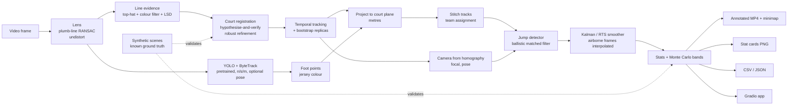

# court-vision

Volleyball analytics from one fixed camera, with no model training: classical computer vision and
3D geometry around a pretrained person detector. Point it at amateur footage and get player
positions in metres, distance, speed, jumps, heatmaps and an annotated video with a live top-down
minimap.


The clip above is drone footage of an outdoor court. The court is found from its painted lines,
re-registered on every frame (the drone drifts), and every player is tracked on the court plane.

| Best frame | Match summary card |
|---|---|
|  |  |
|  |  |

## What it does

1. **Lens** - estimates radial distortion from straight court lines (plumb-line method with
   RANSAC over line chains, one-parameter division model) and undistorts. No checkerboard.
2. **Court registration** - line segments (LSD, with a white-line colour filter) are merged into
   lines; two pairs of lines plus a template assignment give a homography hypothesis, scored by how
   much of the full court template lands on line pixels (hypothesise-and-verify over line
   correspondences, exhaustive when small, randomly sampled when large). The winner is refined with a
   robust least-squares fit on all line pixels and tracked frame to frame. Templates: indoor 18x9 m,
   beach 16x8 m, plus padel and 5/7-a-side football.
3. **Players** - pretrained Ultralytics YOLO (weights downloaded from GitHub) + ByteTrack;
   fragments broken by occlusion are stitched in court space; teams from side of the net plus jersey
   colour clustering; foot points projected to the court plane and smoothed with a Kalman/RTS filter
   in metres.
4. **Jumps** - a jump is a short ballistic bump of the foot point along the projected vertical.
   During the airborne phase the ground position is interpolated between take-off and landing
   instead of projecting the airborne point, and height is measured from the camera recovered from
   the homography. An optional pose model supplies ankle keypoints.
5. **Stats** - distance, top/average speed, jump count, max/average jump height, heatmap,
   front-row vs back-row occupancy, each with a 90% band from Monte Carlo propagation of homography
   uncertainty (block bootstrap of the line fit), foot-localisation bias and tracker jitter.
6. **Outputs** - side-by-side annotated MP4 (H.264) with minimap, per-player stat cards (PNG),
   CSV/JSON, GIF, and a Gradio app.
7. **Validation** - synthetic courts rendered with known intrinsics, pose and distortion, clutter
   lines from basketball and badminton, simulated players with occlusions and jumps.

## Architecture



| Module | File |
|---|---|
| Lens | `courtvision/lens.py` |
| Court registration | `courtvision/court.py`, `courtvision/templates.py` |
| Camera from homography | `courtvision/camera.py` |
| Players | `courtvision/players.py`, `courtvision/tracking.py` |
| Jumps | `courtvision/jumps.py` |
| Stats + Monte Carlo | `courtvision/stats.py` |
| Rendering, exports | `courtvision/render.py`, `courtvision/pipeline.py` |
| Synthetic scenes, validation | `courtvision/synth.py`, `courtvision/validate.py` |

## Quick start

```bash
pip install -r requirements.txt
python -m courtvision run clip.mp4 --out results/clip --frame-stride 2
```

Useful flags:

| Flag | Meaning |
|---|---|
| `--device auto\|cpu\|cuda` | auto-detects CUDA |
| `--model-size n\|s\|m` | YOLO size |
| `--pose` | pose model: ankle keypoints for foot points and jumps |
| `--frame-stride N`, `--max-frames N` | fast development runs on CPU |
| `--court indoor\|beach\|padel\|football5\|football7` | court template |
| `--undistort auto\|off\|<lambda>` | lens handling |
| `--line-color white\|any` | `any` if your court lines are not white |

Outputs in `--out`: `*_annotated.mp4`, `*_demo.gif`, `best_frame.png`, `cards/*.png`,
`player_stats.csv`, `positions.csv`, `jumps.csv`, `summary.json`.

Other entry points:

```bash
python app.py                                         # Gradio: upload clip -> results
python scripts/validate_synthetic.py --trials 24      # synthetic validation + sensitivity
python scripts/benchmark.py clip.mp4 --device cuda --model-size s   # FPS per stage
pytest                                                # tests
```

## Results

Full tables: [docs/RESULTS.md](docs/RESULTS.md).

### Synthetic validation

Each scenario is 24 random scenes: a camera 25-60 degrees above the horizon (unless stated),
12 players for 20 s at 25 fps, 1.5 px foot noise, occlusion gaps, jumps of 20-75 cm. Court
registration runs on the rendered image; player detections are simulated (noisy foot pixels with
dropouts and known identity), so these numbers cover geometry, smoothing, jumps and stats, not the
YOLO detector or ID switches.

<<VALIDATION>>

How to read it:

- **Court found** counts a scene as a success only if the fitted court is within 50 cm of the truth.
- **Flight-time MAE** is the error of the second, independent height estimate `g*T^2/8`.
- **Truth in 90% band** is how often the true distance falls inside the reported band.

What the sweep shows:

<<FINDINGS>>

### Real footage

<<CLIP>>

There is no ground truth for the real clips, so these numbers are plausibility-checked only
(overlay alignment by eye, speeds in a human range). Jumps were checked by eye against the
frames: see the jump section under Limitations.

### Speed

<<BENCH>>

Rerun on a GPU with `python scripts/benchmark.py clip.mp4 --device cuda`; detection is the
bottleneck on CPU and the stage that moves to the GPU.

## Limitations

- The camera must not pan or zoom. Slow drift is tracked.
- Court lines must be visible. Halls where every sport's lines share one colour are a known weak
  case (see the table). `--line-color` and the strength-weighted scoring help only when the
  volleyball lines differ in colour or contrast.
- Jump height needs an oblique view. From a height `Cz` at horizontal distance `rho`, a jump of `z`
  moves the apparent ground point by `z*rho/Cz`; under a steep camera this is indistinguishable
  from a quick step, and such jumps are dropped rather than reported.
- **Jumps on real footage are conservative and still imperfect.** Foot points come from box
  bottoms (or ankles with `--pose`), and box bottoms also move when a player crouches, bends, or
  has their legs hidden by the net. Three checks reject those cases: the box must not shrink, the
  box top must rise with the feet, and the bump must be large compared with posture jitter. On the
  three demo clips this cut detections from 25 to 6. By eye, 3 of the 6 are real actions (a block,
  a jump serve, a jump set), and some real blocks at the net are missed. Treat per-player jump
  counts as indicative, not as a stat to publish.
- Player labels are per clip. No jersey numbers, no ball tracking.
- Uncertainty bands cover calibration, foot bias and tracker jitter; they do not cover identity
  switches.

## Hire me

I build computer-vision pipelines like this one for sports clubs, venues and product teams:
player tracking and statistics from your footage, camera calibration and top-down views, and
deployment on edge devices next to your cameras.

- Upwork: <<UPWORK_PROFILE_URL>>
- GitHub: https://github.com/phamthaihoangtung

Send a 30-second sample clip and I will tell you what accuracy to expect before you commit.

## License

MIT for the code. YOLO weights are downloaded from Ultralytics at run time and carry their own
licence (AGPL-3.0 / Ultralytics Enterprise) - check it before commercial deployment.
